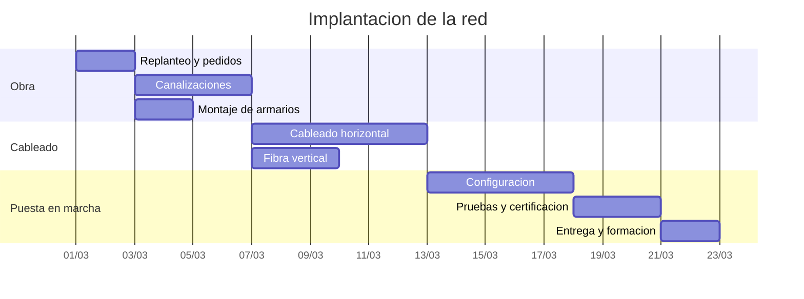

# Planificación de proyectos · Guía de laboratorio

> **Para qué sirve.** Un plan se entiende cuando lo has calculado a mano y lo has visto confirmado por
> una máquina. Cinco prácticas: camino crítico en código, simulación de plazos, planificación en una
> herramienta, presupuesto con fórmulas y un cuadro de mando con valor ganado.

| Práctica | Herramienta | Qué demuestras | Tiempo |
| --- | --- | --- | --- |
| 1. Camino crítico en Python | Python | Que el algoritmo coincide con tu cálculo | 45 min |
| 2. Simulación de plazos | Python | Qué probabilidad real tiene una fecha | 45 min |
| 3. Planificar en una herramienta | GanttProject, ProjectLibre o Mermaid | Gantt, dependencias, recursos | 90 min |
| 4. Presupuesto con fórmulas | Hoja de cálculo | Precios descompuestos y base de licitación | 60 min |
| 5. Cuadro de mando de valor ganado | Python | SPI, CPI y EAC y un informe de avance | 45 min |

## Práctica 1. Camino crítico en Python

**Objetivo.** Programar las pasadas hacia adelante y hacia atrás y comprobar el
[caso 1](Planificacion_Casos.md).

```python
tareas = {  # codigo: (duracion, predecesoras)
    "A": (2, []), "B": (4, ["A"]), "C": (6, ["B"]), "D": (3, ["B"]),
    "E": (2, ["A"]), "F": (5, ["C", "D", "E"]), "G": (3, ["F"]), "H": (2, ["G"]),
}

# Orden topologico simple
orden, pendientes = [], dict(tareas)
while pendientes:
    for t, (d, pred) in list(pendientes.items()):
        if all(p in orden for p in pred):
            orden.append(t); del pendientes[t]

# Pasada hacia adelante
ES, EF = {}, {}
for t in orden:
    d, pred = tareas[t]
    ES[t] = max([EF[p] for p in pred], default=0)
    EF[t] = ES[t] + d
fin = max(EF.values())

# Pasada hacia atras
sucesoras = {t: [s for s, (_, pr) in tareas.items() if t in pr] for t in tareas}
LF, LS = {}, {}
for t in reversed(orden):
    LF[t] = min([LS[s] for s in sucesoras[t]], default=fin)
    LS[t] = LF[t] - tareas[t][0]

print("Duracion total:", fin)
print("Tarea  ES  EF  LS  LF  Holgura  Libre")
for t in orden:
    libre = min([ES[s] for s in sucesoras[t]], default=fin) - EF[t]
    print(f"{t:5} {ES[t]:3} {EF[t]:3} {LS[t]:3} {LF[t]:3} {LS[t]-ES[t]:7} {libre:6}")
print("Camino critico:", [t for t in orden if LS[t] == ES[t]])
```

**Qué debes observar.** Duración 22, camino crítico A, B, C, F, G y H, y holguras de 3 para D y de 8
para E, igual que a mano.

**Ampliación.** Retrasa D en 4 días y vuelve a ejecutar: debe aparecer D como crítica y el total
pasar a 23. Añade una tarea con dependencia circular y haz que el programa lo detecte (ahora se
cuelga: ese es el error que una herramienta de planificación avisa).

## Práctica 2. Simulación de plazos

**Objetivo.** Comprobar con una simulación la probabilidad que da la aproximación normal del
[caso 2](Planificacion_Casos.md).

```python
import random
random.seed(1877)
tareas = [(2, 3, 6), (3, 4, 9), (5, 6, 13)]   # optimista, probable, pesimista

def beta_pert(o, m, p):
    a = 1 + 4 * (m - o) / (p - o)
    b = 1 + 4 * (p - m) / (p - o)
    return o + random.betavariate(a, b) * (p - o)

N = 100000
totales = [sum(beta_pert(*t) for t in tareas) for _ in range(N)]
print("Media", round(sum(totales) / N, 2))
for d in (14, 17, 18):
    print(d, "dias:", round(sum(1 for x in totales if x <= d) / N * 100, 1), "por ciento")
```

**Qué debes observar.** Una media de 15,0 y probabilidades de alrededor de 31, 86 y 94 por ciento
para 14, 17 y 18 días, frente a 29, 87 y 95 por ciento de la aproximación normal: coinciden en lo
esencial. Sustituye `beta_pert(*t)` por `random.triangular(t[0], t[2], t[1])` y la media saldrá en 17, no en 15: verás por qué el
PERT pesa cuatro veces el valor probable. La simple media de los tres valores desplaza el resultado.

**Pregunta de cierre.** Con una media de 15 días, ¿qué probabilidad hay de cumplir en 15? Un
50 por ciento. Es la razón por la que no se compromete la media.

## Práctica 3. Planificar en una herramienta

**Objetivo.** Entrar el plan del caso 1 en una herramienta y ver el camino crítico.

**Con GanttProject o ProjectLibre.**

1. Crea el proyecto con fecha de inicio un lunes y un calendario laboral de lunes a viernes.
2. Introduce las ocho tareas con sus duraciones y enlaza las dependencias fin a comienzo.
3. Activa la vista de camino crítico. Debe marcar A, B, C, F, G y H.
4. Asigna recursos: 3 instaladores a C, 2 técnicos a F, y comprueba el gráfico de cargas.
5. Guarda la línea base y mueve D: observa cómo cambia el plazo solo cuando supera su holgura.

**Con Mermaid** (se dibuja en la propia página y se versiona como texto):

````text

````

Mermaid cuenta días naturales, no laborables; para un plan real usa una herramienta con calendario.

**Pregunta de cierre.** ¿Qué información tiene la herramienta que no tiene el diagrama de barras que
dibujaste a mano? (Dependencias, recursos, calendario y línea base.)

## Práctica 4. Presupuesto con fórmulas

**Objetivo.** Construir en una hoja de cálculo el precio descompuesto y la base de licitación del
[caso 4](Planificacion_Casos.md), sin valores pegados.

**Estructura de la hoja.**

| Hoja | Contenido |
| --- | --- |
| Parámetros | Gastos generales, beneficio, IVA, coste horario de oficial y ayudante |
| Descompuestos | Una fila por componente: cantidad, precio, importe (con fórmula) |
| Mediciones | Unidad de obra, cantidad y precio unitario (referencia a Descompuestos) |
| Presupuesto | Capítulos y total, con GG, BI e IVA referenciados a Parámetros |

**Reglas.** Los porcentajes y los costes horarios solo existen en la hoja Parámetros. Cada importe es
una fórmula. Cambia un parámetro y todo se actualiza.

**Comprobación en Python.**

```python
cable, paneles, empalmes = 60 * 4.20, 2 * 118, 16 * 4.5
mano_obra = 6 * 27 + 6 * 21
directos = cable + paneles + empalmes + mano_obra + 38
medios = round(directos * 0.02, 2)
cd = directos + medios
pu = cd + cd * 0.13 + cd * 0.06
print("Directos", directos, "Costes directos", round(cd, 2), "Precio unitario", round(pu, 2))

pem = 84000
base = pem * 1.19
print("Base", base, "IVA", round(base * 0.21, 2), "Total", round(base * 1.21, 2))
```

**Qué debes observar.** Un precio unitario de 1 075,42 euros (1 075,43 si no se redondean GG y BI por separado), una base de 99 960 euros y un total
de 120 951,60 euros. Cambia el beneficio al 8 por ciento en la hoja y comprueba que todo cambia a la
vez: la prueba de que no hay valores pegados.

## Práctica 5. Cuadro de mando de valor ganado

**Objetivo.** Calcular los índices de rendimiento y redactar el informe de avance del
[caso 6](Planificacion_Casos.md).

```python
def evm(BAC, PV, EV, AC, precio_venta):
    spi, cpi = EV / PV, EV / AC
    eac = BAC / cpi
    return {"SPI": round(spi, 2), "CPI": round(cpi, 2), "EAC": round(eac),
            "Desviacion": round(BAC - eac), "ETC": round(eac - AC),
            "Margen": round((precio_venta - eac) / precio_venta * 100, 1)}

print(evm(40000, 22000, 18000, 21000, 45000))
```

**Qué debes observar.** SPI 0,82, CPI 0,86, EAC de 46 667, desviación de menos 6 667 y margen de
menos 3,7 por ciento. Cambia los datos para ver cuándo el margen se vuelve positivo (necesitas un
CPI de al menos 0,89).

**Informe de avance de una página.** Con los resultados anteriores, redacta el informe: estado
(rojo), avance previsto frente a real, desviación de plazo y coste con causa, los tres riesgos
principales con responsable, la decisión que pides al cliente y el próximo periodo. Criterio de
calidad: que quien lo lea en 30 segundos sepa qué pasa y qué se le pide.
