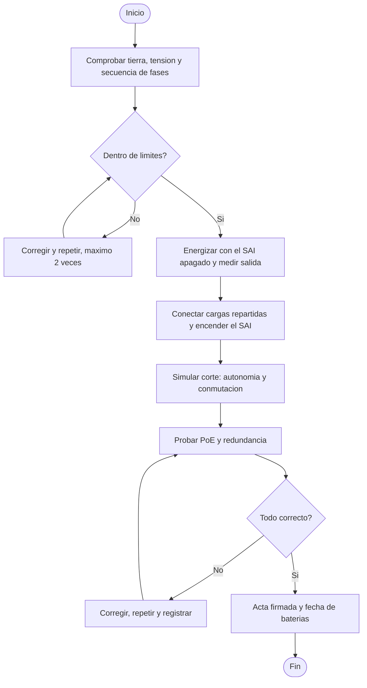

# Ejecución de proyectos · Guía de laboratorio

> **Para qué sirve.** Esta unidad se aprueba midiendo, interpretando y documentando. Estas cinco
> prácticas reproducen en un ordenador los cálculos y los informes de los
> [casos](Ejecucion_Casos.md), y una de ellas es un ensayo de clase.

| Práctica | Herramienta | Qué demuestras | Tiempo |
| --- | --- | --- | --- |
| 1. Valor ganado y proyección | Python | Que sabes elegir la hipótesis de proyección | 40 min |
| 2. Calculadora eléctrica y de SAI | Python | Dimensionado, autonomía y tierra | 40 min |
| 3. Certificación: resultados, Pareto e informe | Python | Que interpretas medidas y priorizas | 60 min |
| 4. Procedimiento operativo con diagrama de flujo | Mermaid | Que sabes redactar y dibujar un POE | 60 min |
| 5. Plan de capacitación e impartición simulada | Plantilla y cronómetro | Que sabes diseñar y dar una sesión | 90 min |

**Seguridad.** Estas prácticas no requieren tocar instalaciones eléctricas. Toda medida real en baja
tensión la hace personal autorizado, con los cinco pasos del trabajo sin tensión y los EPI.

## Práctica 1. Valor ganado y proyección

**Objetivo.** Calcular los índices del [caso 1](Ejecucion_Casos.md) y comparar las dos
hipótesis de proyección.

```python
def evm(BAC, PV, EV, AC):
    cpi, spi = EV / AC, EV / PV
    return {
        "CV": EV - AC, "SV": EV - PV, "CPI": round(cpi, 3), "SPI": round(spi, 2),
        "EAC rendimiento actual": round(BAC / cpi),
        "EAC desviacion puntual": round(AC + (BAC - EV)),
    }

for k, v in evm(120000, 62000, 55800, 63000).items():
    print(k, v)
```

**Qué debes observar.** CV de menos 7 200, SV de menos 6 200, CPI 0,886, SPI 0,90 y dos proyecciones:
135 484 si el rendimiento continúa y 127 200 si fue una desviación puntual. La diferencia (8 284
euros) es lo que cuesta equivocarse de hipótesis.

**Ampliación.** Escribe una función que dada una lista de cortes semanales (PV, EV, AC) imprima la
tendencia de CPI y SPI y avise cuando CPI baje de 0,95 dos semanas seguidas.

## Práctica 2. Calculadora eléctrica y de SAI

**Objetivo.** Reproducir el dimensionado del [caso 3](Ejecucion_Casos.md).

```python
carga = 2100            # W medidos
margen = 1.25
fp = 0.9                # factor de potencia de salida
carga_margen = carga * margen
for kva in (3, 4, 6):
    util = kva * 1000 * fp
    print(f"SAI {kva} kVA: {util:.0f} W utiles, carga {carga_margen / util * 100:.0f} por ciento")

t_h, rend, vbat = 0.25, 0.94, 192
energia = carga * t_h / rend
cap = energia / vbat * 1.25
print(f"Energia en continua {energia:.1f} Wh, capacidad {cap:.2f} Ah")

# Tierra: resistencia maxima admisible para un diferencial y una tension de contacto
for i_dif, vc in ((0.030, 50), (0.030, 24), (0.300, 50)):
    print(f"Diferencial {i_dif*1000:.0f} mA, {vc} V -> resistencia maxima {vc / i_dif:.0f} ohmios")
```

**Qué debes observar.** El SAI de 3 kVA al 97 por ciento (no vale), el de 4 kVA al 73 por ciento
(vale), una capacidad de 3,64 Ah y resistencias máximas de 1 667, 800 y 167 ohmios. Un diferencial
de 300 mA exige una tierra diez veces mejor: es un buen argumento para usar 30 mA en tomas y
mantener la tierra por debajo de 5 ohmios en comunicaciones.

**Ampliación.** Añade la autonomía real con batería envejecida (capacidad al 70 por ciento) y compara
con la de catálogo.

## Práctica 3. Certificación: resultados, Pareto e informe

**Objetivo.** Interpretar los diez enlaces del [caso 4](Ejecucion_Casos.md) y producir el
informe-memoria.

```python
LIMITE = {"IL": 18.5, "NEXT": 41.8, "RL": 14.0}   # informativo: se usan los margenes
enlaces = [  # id, mapa, longitud, margen IL, NEXT, RL
    ("L01", "OK", 62, 1.8, 3.1, 2.0), ("L02", "OK", 70, 1.5, 2.4, 1.7),
    ("L03", "OK", 83, 1.1, 0.1, 1.4), ("L04", "OK", 55, 2.0, -0.8, 1.6),
    ("L05", "OK", 76, 1.2, -1.5, 1.1), ("L06", "OK", 68, 1.6, -0.3, 1.9),
    ("L07", "OK", 94, -0.6, 1.0, 1.2), ("L08", "CRUZADO", 66, 1.7, 2.0, 1.8),
    ("L09", "OK", 58, 1.3, 2.9, 2.2), ("L10", "OK", 72, 1.6, 3.3, 1.9),
]

causas = {}
print("Enlace  Resultado   Margen minimo  Causa")
for ide, mapa, long_, il, nx, rl in enlaces:
    causa = ""
    if mapa != "OK":
        causa = "Mapa incorrecto"
    elif il < 0:
        causa = "Longitud sobre 90 m"
    elif nx < 0:
        causa = "Destrenzado (NEXT)"
    elif rl < 0:
        causa = "Perdida de retorno"
    minimo = min(il, nx, rl)
    if causa:
        causas[causa] = causas.get(causa, 0) + 1
        res = "FALLA"
    else:
        res = "PASA" if minimo >= 1.0 else "PASA (fragil)"
    print(f"{ide:6} {res:13} {minimo:5.1f} dB      {causa}")

total_fallos = sum(causas.values())
acum = 0
print("\nPareto")
for c, n in sorted(causas.items(), key=lambda x: -x[1]):
    acum += n
    print(f"{c:22} {n}  {n / total_fallos * 100:5.1f} por ciento  acumulado {acum / total_fallos * 100:5.1f}")
```

**Qué debes observar.** 5 enlaces pasan (uno de ellos, L03, de forma frágil) y 5 fallan, con un Pareto de
60 por ciento por destrenzado, 20 por ciento por longitud y 20 por ciento por mapa. Es el
resultado del caso.

**Informe-memoria.** Con los datos de la ejecución, redacta una página con los apartados de la
sección 4.9 del técnico. Cuida la **interpretación**: para cada fallo, qué valor se obtuvo, cuál era
el de referencia, qué diferencia hay y cuál es la causa más probable. Aunque la herramienta imprima
el resultado, el informe lo firma una persona que lo ha entendido.

**Ampliación.** Lee los resultados de un fichero CSV y genera el informe en Markdown con una tabla
de enlaces y una lista de acciones por causa.

## Práctica 4. Procedimiento operativo con diagrama de flujo

**Objetivo.** Redactar el procedimiento de puesta en servicio del [caso 2](Ejecucion_Casos.md)
con su diagrama, dibujado con Mermaid (se dibuja como texto y se versiona).

````text

````

**Pasos.**

1. Redacta el POE con los **nueve apartados** del formato normalizado (tabla del caso 2).
2. Dibuja el diagrama con Mermaid y revisa que toda decisión tenga dos salidas.
3. Pídele a otra persona que lo ejecute sin ayuda: ese es el **piloto**. Anota dónde duda.
4. Corrige, sube de versión (v1.1), apunta el motivo del cambio y retira la anterior.

**Preguntas de cierre.** ¿Qué criterio de aceptación es medible y cuál es una opinión? ¿Qué pasa si no
hay acción ante desviación en el procedimiento?

## Práctica 5. Plan de capacitación e impartición simulada

**Objetivo.** Diseñar un plan de formación y dar diez minutos de una sesión.

**Parte A. Diseña.** Elige un procedimiento de esta unidad (certificar un enlace, medir la tierra o
probar un SAI) y completa la plantilla:

| Elemento | Tu respuesta |
| --- | --- |
| Destinatarios y nivel de partida | |
| Objetivo (verbo observable, condición y criterio) | |
| Contenido conceptual | |
| Contenido procedimental | |
| Contenido actitudinal | |
| Metodología y justificación | |
| Secuencia con tiempos | |
| Evaluación: evidencia y rúbrica de tres niveles | |
| Coste y ahorro previsto | |

**Parte B. Calcula el retorno** y el plazo de recuperación:

```python
alumnos, horas, coste_h = 5, 6, 30
formador_h, coste_f, material = 6, 60, 120
coste = alumnos * horas * coste_h + formador_h * coste_f + material
ahorro_anual = 15 * 90          # 15 revisitas evitadas, 90 euros cada una
print("Coste", coste, "Ahorro anual", ahorro_anual,
      "Recuperacion en meses", round(coste / ahorro_anual * 12, 1))
```

**Parte C. Impartición simulada de diez minutos.** Prepara una presentación de cinco diapositivas
(una idea cada una, un guion y un elemento gráfico de calidad) y da diez minutos a un compañero o a
una grabación de tu móvil. Explica con detenimiento cada acción **como si fuera real**. Revisa la
grabación con esta lista:

| Criterio | Sí o no |
| --- | --- |
| El objetivo se dice al principio y es observable | |
| Una idea por diapositiva y texto breve | |
| Cada acción se explica: qué, por qué y qué se comprueba | |
| Hay una pregunta para verificar la comprensión | |
| Se resume y se evalúa al final | |
| Se respeta el tiempo | |

**Reflexión.** ¿Qué parte de la sesión se parecía más a explicar y cuál a enseñar? Enseñar es que
la otra persona haga algo nuevo al terminar.
